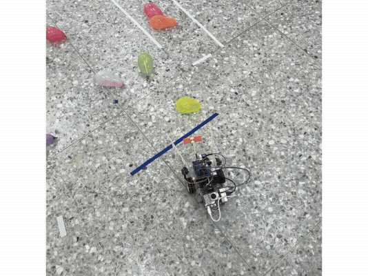

# BalloonPopBot

以 Raspberry Pi 執行攝影機影像辨識，透過 USB serial 控制 Arduino 的氣球追蹤車專案。提供獨立 Python 程式與 ROS 2 節點，Arduino 負責雙馬達及三個伺服馬達。

本專案包含 YOLO TFLite 模型、訓練資料集與示範影片。執行控制程式仍需要實體硬體及相容的推論環境。

## 示範



## 架構

```text
USB camera -> Raspberry Pi / YOLO TFLite
                         |
                  tracking decisions
                         |
                 USB serial (115200)
                         |
                   Arduino firmware
                         |
             L298N motors + SG90 servos
```

| 路徑 | 用途 |
| --- | --- |
| `balloon_pop.py` | 獨立 Python 入口與追蹤控制邏輯 |
| `pi_controll.ino` | Arduino 韌體 |
| `ros2_ws/src/balloon_pop_bot/` | ROS 2 Python package、launch 與 legacy 控制程式 |
| `README_ROS2.md` | ROS 2 行為與 topics 說明 |
| `requirements.txt` | 共用 Python 直接依賴 |
| `PUBLISHING.md` | 公開前檢查與授權事項 |

資料集、兩個 TFLite 模型與既有示範影片均保留於公開範圍。虛擬環境、ROS 建置結果、runtime 資料及備份由 .gitignore 排除。

| 資產 | 說明 |
| --- | --- |
| `balloon_dataset_merged/` | 既有影像與標註資料；實際切分與類別須依資料內容核對 |
| `best_float16.tflite` | 程式預設使用的模型 |
| `best.tflite` | 另一份模型；量化方式與效能差異未驗證 |
| 根目錄 MP4 | 既有示範錄影 |

影像資料約 561 MiB，示範影片約 35 MiB。一般 clone 會包含這些資產，首次下載較大。

## 環境與安裝

需要 Raspberry Pi/Linux、USB 攝影機、相容 Arduino、L298N 馬達驅動及伺服機構。ROS 2 模式另需已安裝且與作業系統相容的 ROS 2、`rclpy`、`std_msgs`、`launch`、`launch_ros` 與 colcon。

以下命令均從專案根目錄開始。ROS 2 使用的 Python 必須與 ROS 安裝版本相容；先載入該 ROS 發行版的環境，再建立虛擬環境。

```bash
python3 -m venv --system-site-packages .venv
source .venv/bin/activate
python -m pip install -r requirements.txt
```

`requirements.txt` 未鎖定版本，尚無經驗證的完整相容性組合。TFLite 推論還需要與 Raspberry Pi 架構、Python 及 Ultralytics 相容的 TensorFlow 或 TFLite runtime；請另行安裝並驗證。不要依賴首次執行時自動下載依賴或模型。

Arduino IDE 需提供 `Servo.h`。將韌體放入同名 sketch 資料夾後，以正確開發板與 serial port 編譯、上傳。接線以 `pi_controll.ino` 為準：

| 元件 | Arduino 腳位 |
| --- | --- |
| 左馬達 ENA / IN1 / IN2 | 5 / 8 / 9 |
| 右馬達 ENB / IN3 / IN4 | 6 / 10 / 11 |
| 刺破 / 左夾具 / 右夾具伺服 | 4 / 7 / 12 |

## 模型與設定

預設使用根目錄已附的 `best_float16.tflite`。替換模型時，需確認輸入尺寸、輸出格式及類別與設定相容；本次整理未執行模型推論。

獨立程式的設定在 `balloon_pop.py` 頂部：模型路徑、serial port、camera index、辨識門檻、類別及動作參數。預設模型路徑相對於啟動時的工作目錄。

ROS 2 可透過 launch arguments 指定 `model_path`、`serial_port`、`camera_id`、`conf_thres` 與 `startup_sequence`；其餘參數請參閱節點原始碼。ROS 2 預設只選 class 0，獨立版本預設接受 class 0 到 6；請核對自己的模型類別，兩者設定不同。

目前程式不讀取 `.env`，也不需要 API key，因此未建立 `.env.example` 或 Docker Compose 範本。

## 啟動

**啟動可能立即驅動馬達，並在辨識到目標後操作夾具及刺破機構。** 先架空輪子、隔離尖銳機構並備妥實體斷電方式，再進行測試。

獨立版本從根目錄執行：

```bash
source .venv/bin/activate
python balloon_pop.py
```

ROS 2 版本先在已載入 ROS 環境及虛擬環境的終端機建置：

```bash
cd ros2_ws
colcon build --packages-select balloon_pop_bot
source install/setup.bash
cd ..
ros2 launch balloon_pop_bot balloon_pop.launch.py \
  model_path:="$PWD/best_float16.tflite" \
  serial_port:=/dev/ttyUSB0 \
  camera_id:=0 \
  startup_sequence:=false
```

`startup_sequence:=false` 只略過起步暖機與固定前進，後續仍會自動搜尋、追蹤及操作機構。Arduino 裝置可能是 `/dev/ttyACM0`；也需確認使用者具備該裝置存取權。

## ROS 2 介面

| Topic | 型別 | 用途 |
| --- | --- | --- |
| `/balloon_pop_bot/action` | std_msgs/String | 目前動作 |
| `/balloon_pop_bot/status` | std_msgs/String | 文字狀態 |
| `/balloon_pop_bot/target` | std_msgs/String | JSON 目標框 |
| `/balloon_pop_bot/area_ratio` | std_msgs/Float32 | 目標佔畫面比例 |
| `/balloon_pop_bot/target_visible` | std_msgs/Bool | 是否偵測到目標 |
| `/balloon_pop_bot/emergency_stop` | std_msgs/Bool | 軟體停止請求 |
| `/balloon_pop_bot/manual_command` | std_msgs/String | Arduino 指令 |

軟體停止請求：

```bash
ros2 topic pub --once /balloon_pop_bot/emergency_stop std_msgs/Bool "{data: true}"
```

Arduino 協定包含 `M left right`、`S`、`OPEN`、`CLOSE`、`STAB`，另支援 `PING` 與 `P`。ROS callback 與阻塞式動作共用執行流程，軟體停止可能延遲；韌體也沒有通訊中斷自動停止的 watchdog。務必保留實體斷電措施，勿將 ROS topic 當作硬體急停。

## 公開與驗證

專案所有者已確認內容可公開，資料集、模型與影片未被排除。package metadata 雖標示 MIT，目前尚無根目錄 LICENSE；仍需由權利人確認要採用的正式授權及著作權資訊。

本次整理未啟動攝影機、serial、馬達或 ROS 節點，未連線外部服務；硬體行為、模型載入與依賴相容性尚待實機驗證。完整公開檢查見 [PUBLISHING.md](PUBLISHING.md)。
